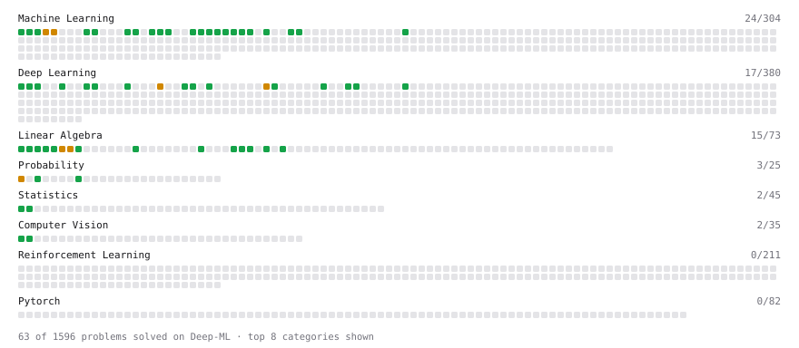

# Deep-ML

My machine learning practice from [Deep-ML](https://www.deep-ml.com). Every solution here was written by hand.

**99** solved · 85 problems · 0 labs · 14 math

[**Browse the interactive portfolio**](https://cdy3870.github.io/deep-ml/) to replay this filling in over time.

## Problems

| | Difficulty | Solved | |
| --- | --- | --- | --- |
| [Adagrad Optimizer](https://www.deep-ml.com/problems/145) | easy | 2026-08-07 | [solution](problems/0145-adagrad-optimizer) |
| [Batch Iterator for Dataset](https://www.deep-ml.com/problems/30) | easy | 2026-07-23 | [solution](problems/0030-batch-iterator-for-dataset) |
| [Binary Classification with Logistic Regression](https://www.deep-ml.com/problems/104) | easy | 2026-08-06 | [solution](problems/0104-binary-classification-with-logistic-regression) |
| [Calculate 2x2 Matrix Inverse](https://www.deep-ml.com/problems/8) | easy | 2026-07-19 | [solution](problems/0008-calculate-2x2-matrix-inverse) |
| [Calculate Accuracy Score](https://www.deep-ml.com/problems/36) | easy | 2026-07-23 | [solution](problems/0036-calculate-accuracy-score) |
| [Calculate Computational Efficiency of MoE](https://www.deep-ml.com/problems/123) | easy | 2026-08-21 | [solution](problems/0123-calculate-computational-efficiency-of-moe) |
| [Calculate Cosine Similarity Between Vectors](https://www.deep-ml.com/problems/76) | easy | 2026-08-01 | [solution](problems/0076-calculate-cosine-similarity-between-vectors) |
| [Calculate Covariance Matrix](https://www.deep-ml.com/problems/10) | easy | 2026-07-19 | [solution](problems/0010-calculate-covariance-matrix) |
| [Calculate Dice Score for Classification](https://www.deep-ml.com/problems/73) | easy | 2026-08-01 | [solution](problems/0073-calculate-dice-score-for-classification) |
| [Calculate Image Brightness](https://www.deep-ml.com/problems/70) | easy | 2026-07-31 | [solution](problems/0070-calculate-image-brightness) |
| [Calculate Jaccard Index for Binary Classification](https://www.deep-ml.com/problems/72) | easy | 2026-07-31 | [solution](problems/0072-calculate-jaccard-index-for-binary-classification) |
| [Calculate Mean Absolute Error (MAE)](https://www.deep-ml.com/problems/93) | easy | 2026-08-04 | [solution](problems/0093-calculate-mean-absolute-error-mae) |
| [Calculate Mean by Row or Column](https://www.deep-ml.com/problems/4) | easy | 2026-07-19 | [solution](problems/0004-calculate-mean-by-row-or-column) |
| [Calculate R-squared for Regression Analysis](https://www.deep-ml.com/problems/69) | easy | 2026-07-27 | [solution](problems/0069-calculate-r-squared-for-regression-analysis) |
| [Calculate Root Mean Square Error (RMSE)](https://www.deep-ml.com/problems/71) | easy | 2026-07-31 | [solution](problems/0071-calculate-root-mean-square-error-rmse) |
| [Compute Multi-class Cross-Entropy Loss](https://www.deep-ml.com/problems/134) | easy | 2026-08-22 | [solution](problems/0134-compute-multi-class-cross-entropy-loss) |
| [Compute the Cross Product of Two 3D Vectors](https://www.deep-ml.com/problems/118) | easy | 2026-08-21 | [solution](problems/0118-compute-the-cross-product-of-two-3d-vectors) |
| [Compute TTFT ITL and TPS from a Token Timestamp Stream](https://www.deep-ml.com/problems/411) | easy | 2026-10-09 | [solution](problems/0411-compute-ttft-itl-and-tps-from-a-token-timestamp-stream) |
| [Convert Vector to Diagonal Matrix](https://www.deep-ml.com/problems/35) | easy | 2026-07-26 | [solution](problems/0035-convert-vector-to-diagonal-matrix) |
| [Derivatives of Activation Functions](https://www.deep-ml.com/problems/217) | easy | 2026-09-17 | [solution](problems/0217-derivatives-of-activation-functions) |
| [Descriptive Statistics Calculator](https://www.deep-ml.com/problems/78) | easy | 2026-08-02 | [solution](problems/0078-descriptive-statistics-calculator) |
| [Detect Overfitting or Underfitting](https://www.deep-ml.com/problems/86) | easy | 2026-08-01 | [solution](problems/0086-detect-overfitting-or-underfitting) |
| [Dot Product Calculator](https://www.deep-ml.com/problems/83) | easy | 2026-08-01 | [solution](problems/0083-dot-product-calculator) |
| [Expected Value and Variance of an n-Sided Die](https://www.deep-ml.com/problems/179) | easy | 2026-09-05 | [solution](problems/0179-expected-value-and-variance-of-an-n-sided-die) |
| [Feature Scaling Implementation](https://www.deep-ml.com/problems/16) | easy | 2026-07-21 | [solution](problems/0016-feature-scaling-implementation) |
| [Generate a Confusion Matrix for Binary Classification](https://www.deep-ml.com/problems/75) | easy | 2026-08-01 | [solution](problems/0075-generate-a-confusion-matrix-for-binary-classification) |
| [Goodput vs Throughput under a P99 SLA](https://www.deep-ml.com/problems/1307) | easy | 2026-10-11 | [solution](problems/1307-goodput-vs-throughput-under-a-p99-sla) |
| [Grayscale Image Contrast Calculator](https://www.deep-ml.com/problems/82) | easy | 2026-08-01 | [solution](problems/0082-grayscale-image-contrast-calculator) |
| [Handle Missing Data in pandas (dropna/fillna)](https://www.deep-ml.com/problems/1128) | easy | 2026-10-05 | [solution](problems/1128-handle-missing-data-in-pandas-dropna-fillna) |
| [Implement F-Score Calculation for Binary Classification](https://www.deep-ml.com/problems/61) | easy | 2026-07-26 | [solution](problems/0061-implement-f-score-calculation-for-binary-classification) |
| [Implement Gini Impurity Calculation for a Set of Classes](https://www.deep-ml.com/problems/64) | easy | 2026-07-26 | [solution](problems/0064-implement-gini-impurity-calculation-for-a-set-of-classes) |
| [Implement Orthogonal Projection of a Vector onto a Line](https://www.deep-ml.com/problems/66) | easy | 2026-07-27 | [solution](problems/0066-implement-orthogonal-projection-of-a-vector-onto-a-line) |
| [Implement Precision Metric](https://www.deep-ml.com/problems/46) | easy | 2026-07-25 | [solution](problems/0046-implement-precision-metric) |
| [Implement Recall Metric in Binary Classification](https://www.deep-ml.com/problems/52) | easy | 2026-07-25 | [solution](problems/0052-implement-recall-metric-in-binary-classification) |
| [Implement ReLU Activation Function](https://www.deep-ml.com/problems/42) | easy | 2026-07-25 | [solution](problems/0042-implement-relu-activation-function) |
| [Implement Ridge Regression Loss Function](https://www.deep-ml.com/problems/43) | easy | 2026-07-25 | [solution](problems/0043-implement-ridge-regression-loss-function) |
| [Implement SwiGLU activation function](https://www.deep-ml.com/problems/156) | easy | 2026-09-05 | [solution](problems/0156-implement-swiglu-activation-function) |
| [Implement the ELU Activation Function](https://www.deep-ml.com/problems/97) | easy | 2026-08-06 | [solution](problems/0097-implement-the-elu-activation-function) |
| [Implement the Hard Sigmoid Activation Function](https://www.deep-ml.com/problems/96) | easy | 2026-08-05 | [solution](problems/0096-implement-the-hard-sigmoid-activation-function) |
| [Implement the Softplus Activation Function](https://www.deep-ml.com/problems/99) | easy | 2026-08-21 | [solution](problems/0099-implement-the-softplus-activation-function) |
| [Implementation of Log Softmax Function](https://www.deep-ml.com/problems/39) | easy | 2026-07-25 | [solution](problems/0039-implementation-of-log-softmax-function) |
| [KL Divergence Between Two Normal Distributions](https://www.deep-ml.com/problems/56) | easy | 2026-07-26 | [solution](problems/0056-kl-divergence-between-two-normal-distributions) |
| [KV Cache Size Estimator for MLA vs MHA vs GQA](https://www.deep-ml.com/problems/1012) | easy | 2026-10-09 | [solution](problems/1012-kv-cache-size-estimator-for-mla-vs-mha-vs-gqa) |
| [Leaky ReLU Activation Function](https://www.deep-ml.com/problems/44) | easy | 2026-07-25 | [solution](problems/0044-leaky-relu-activation-function) |
| [Linear Kernel Function](https://www.deep-ml.com/problems/45) | easy | 2026-07-25 | [solution](problems/0045-linear-kernel-function) |
| [Linear Regression Using Gradient Descent](https://www.deep-ml.com/problems/15) | easy | 2026-07-21 | [solution](problems/0015-linear-regression-using-gradient-descent) |
| [Linear Regression Using Normal Equation](https://www.deep-ml.com/problems/14) | easy | 2026-07-21 | [solution](problems/0014-linear-regression-using-normal-equation) |
| [Matrix-Vector Dot Product](https://www.deep-ml.com/problems/1) | easy | 2026-07-19 | [solution](problems/0001-matrix-vector-dot-product) |
| [Momentum Optimizer](https://www.deep-ml.com/problems/146) | easy | 2026-08-08 | [solution](problems/0146-momentum-optimizer) |
| [One-Hot Encoding of Nominal Values](https://www.deep-ml.com/problems/34) | easy | 2026-07-23 | [solution](problems/0034-one-hot-encoding-of-nominal-values) |
| [Phi Transformation for Polynomial Features](https://www.deep-ml.com/problems/84) | easy | 2026-08-01 | [solution](problems/0084-phi-transformation-for-polynomial-features) |
| [Poisson Distribution Probability Calculator](https://www.deep-ml.com/problems/81) | easy | 2026-08-01 | [solution](problems/0081-poisson-distribution-probability-calculator) |
| [Random Shuffle of Dataset](https://www.deep-ml.com/problems/29) | easy | 2026-07-23 | [solution](problems/0029-random-shuffle-of-dataset) |
| [Repetition, Frequency, Presence Penalties and Stop Sequences](https://www.deep-ml.com/problems/1308) | easy | 2026-10-14 | [solution](problems/1308-repetition-frequency-presence-penalties-and-stop-sequences) |
| [Reshape Matrix](https://www.deep-ml.com/problems/3) | easy | 2026-07-19 | [solution](problems/0003-reshape-matrix) |
| [Sampling Distribution of the Mean](https://www.deep-ml.com/problems/181) | easy | 2026-09-10 | [solution](problems/0181-sampling-distribution-of-the-mean) |
| [Scalar Multiplication of a Matrix](https://www.deep-ml.com/problems/5) | easy | 2026-07-19 | [solution](problems/0005-scalar-multiplication-of-a-matrix) |
| [Sigmoid Activation Function Understanding](https://www.deep-ml.com/problems/22) | easy | 2026-07-21 | [solution](problems/0022-sigmoid-activation-function-understanding) |
| [Single Neuron](https://www.deep-ml.com/problems/24) | easy | 2026-07-22 | [solution](problems/0024-single-neuron) |
| [Smooth L1 Loss with a Beta Parameter](https://www.deep-ml.com/problems/1372) | easy | 2026-09-11 | [solution](problems/1372-smooth-l1-loss-with-a-beta-parameter) |
| [Softmax Activation Function Implementation ](https://www.deep-ml.com/problems/23) | easy | 2026-07-21 | [solution](problems/0023-softmax-activation-function-implementation) |
| [StepLR Learning Rate Scheduler](https://www.deep-ml.com/problems/153) | easy | 2026-08-22 | [solution](problems/0153-steplr-learning-rate-scheduler) |
| [Transpose of a Matrix](https://www.deep-ml.com/problems/2) | easy | 2026-07-19 | [solution](problems/0002-transpose-of-a-matrix) |
| [Vector Element-wise Sum](https://www.deep-ml.com/problems/121) | easy | 2026-08-21 | [solution](problems/0121-vector-element-wise-sum) |
| [Adam Optimizer](https://www.deep-ml.com/problems/87) | medium | 2026-08-22 | [solution](problems/0087-adam-optimizer) |
| [Binomial Distribution Probability](https://www.deep-ml.com/problems/79) | medium | 2026-08-23 | [solution](problems/0079-binomial-distribution-probability) |
| [Calculate Eigenvalues of a Matrix](https://www.deep-ml.com/problems/6) | medium | 2026-08-08 | [solution](problems/0006-calculate-eigenvalues-of-a-matrix) |
| [Continuous Batching (In-Flight Batching) Simulator](https://www.deep-ml.com/problems/425) | medium | 2026-10-10 | [solution](problems/0425-continuous-batching-in-flight-batching-simulator) |
| [Divide Dataset Based on Feature Threshold](https://www.deep-ml.com/problems/31) | medium | 2026-09-11 | [solution](problems/0031-divide-dataset-based-on-feature-threshold) |
| [Draft-Target Speculative Decoding Simulation](https://www.deep-ml.com/problems/430) | medium | 2026-10-17 | [solution](problems/0430-draft-target-speculative-decoding-simulation) |
| [End-to-End Latency Decomposition](https://www.deep-ml.com/problems/413) | medium | 2026-10-10 | [solution](problems/0413-end-to-end-latency-decomposition) |
| [Estimate KV Cache Size from Model Config](https://www.deep-ml.com/problems/418) | medium | 2026-10-09 | [solution](problems/0418-estimate-kv-cache-size-from-model-config) |
| [Evaluate Translation Quality with METEOR Score](https://www.deep-ml.com/problems/110) | medium | 2026-09-12 | [solution](problems/0110-evaluate-translation-quality-with-meteor-score) |
| [Greedy Streaming Decoder with KV Cache](https://www.deep-ml.com/problems/1055) | medium | 2026-10-15 | [solution](problems/1055-greedy-streaming-decoder-with-kv-cache) |
| [Implement Batch Normalization for BCHW Input](https://www.deep-ml.com/problems/115) | medium | 2026-08-23 | [solution](problems/0115-implement-batch-normalization-for-bchw-input) |
| [Implement Grouped Query Attention (GQA)](https://www.deep-ml.com/problems/391) | medium | 2026-10-18 | [solution](problems/0391-implement-grouped-query-attention-gqa) |
| [Implement K-Fold Cross-Validation](https://www.deep-ml.com/problems/18) | medium | 2026-07-30 | [solution](problems/0018-implement-k-fold-cross-validation) |
| [Implementing ROUGE Score](https://www.deep-ml.com/problems/152) | medium | 2026-09-14 | [solution](problems/0152-implementing-rouge-score) |
| [INT8 KV-Cache Quantize and Dequantize](https://www.deep-ml.com/problems/1302) | medium | 2026-10-19 | [solution](problems/1302-int8-kv-cache-quantize-and-dequantize) |
| [K-Means Clustering](https://www.deep-ml.com/problems/17) | medium | 2026-07-28 | [solution](problems/0017-k-means-clustering) |
| [KV Cache for Efficient Autoregressive Attention](https://www.deep-ml.com/problems/376) | medium | 2026-10-17 | [solution](problems/0376-kv-cache-for-efficient-autoregressive-attention) |
| [Matrix Transformation ](https://www.deep-ml.com/problems/7) | medium | 2026-08-02 | [solution](problems/0007-matrix-transformation) |
| [Simulate Markov Chain Transitions](https://www.deep-ml.com/problems/132) | medium | 2026-09-13 | [solution](problems/0132-simulate-markov-chain-transitions) |
| [Temperature Sampling](https://www.deep-ml.com/problems/378) | medium | 2026-10-12 | [solution](problems/0378-temperature-sampling) |
| [Top-p (Nucleus) Sampling](https://www.deep-ml.com/problems/383) | medium | 2026-10-13 | [solution](problems/0383-top-p-nucleus-sampling) |

## Math

| | Difficulty | Solved | |
| --- | --- | --- | --- |
| [Attention as a Soft Dictionary Lookup](https://www.deep-ml.com/math-problems/133) | easy | 2026-09-25 | [solution](math/0133-attention-as-a-soft-dictionary-lookup) |
| [Bytes in the KV Cache (MHA, GQA, MQA, MLA)](https://www.deep-ml.com/math-problems/62) | easy | 2026-10-10 | [solution](math/0062-bytes-in-the-kv-cache-mha-gqa-mqa-mla) |
| [Derivatives and Gradients](https://www.deep-ml.com/math-problems/1) | easy | 2026-09-24 | [solution](math/0001-derivatives-and-gradients) |
| [PagedAttention Internal Fragmentation](https://www.deep-ml.com/math-problems/67) | easy | 2026-09-30 | [solution](math/0067-pagedattention-internal-fragmentation) |
| [Prefix-Cache Hit Rate and TTFT](https://www.deep-ml.com/math-problems/68) | easy | 2026-09-30 | [solution](math/0068-prefix-cache-hit-rate-and-ttft) |
| [Tokens at Matched Accuracy](https://www.deep-ml.com/math-problems/143) | easy | 2026-10-08 | [solution](math/0143-tokens-at-matched-accuracy) |
| [Why Minibatches: Gradient Variance vs Batch Size](https://www.deep-ml.com/math-problems/130) | easy | 2026-09-24 | [solution](math/0130-why-minibatches-gradient-variance-vs-batch-size) |
| [Kernel Fusion Arithmetic: Bytes Saved and Launches Avoided](https://www.deep-ml.com/math-problems/173) | medium | 2026-09-29 | [solution](math/0173-kernel-fusion-arithmetic-bytes-saved-and-launches-avoided) |
| [Quantized KV: Scale, Zero-Point, and Extra Bytes](https://www.deep-ml.com/math-problems/69) | medium | 2026-09-27 | [solution](math/0069-quantized-kv-scale-zero-point-and-extra-bytes) |
| [Speculative Decoding: Expected Accepted Tokens and Speedup](https://www.deep-ml.com/math-problems/168) | medium | 2026-09-26 | [solution](math/0168-speculative-decoding-expected-accepted-tokens-and-speedup) |
| [Speculative Speedup as a Geometric Series](https://www.deep-ml.com/math-problems/65) | medium | 2026-10-01 | [solution](math/0065-speculative-speedup-as-a-geometric-series) |
| [Tensor Parallelism: Communication per Layer and When It Pays](https://www.deep-ml.com/math-problems/167) | medium | 2026-09-26 | [solution](math/0167-tensor-parallelism-communication-per-layer-and-when-it-pays) |
| [The GPU Memory Hierarchy and the Decode Latency Floor](https://www.deep-ml.com/math-problems/172) | medium | 2026-09-25 | [solution](math/0172-the-gpu-memory-hierarchy-and-the-decode-latency-floor) |
| [Uniform Quantization: Scale and Zero-Point](https://www.deep-ml.com/math-problems/45) | medium | 2026-10-04 | [solution](math/0045-uniform-quantization-scale-and-zero-point) |

---

_This file is regenerated by Deep-ML on every push._
